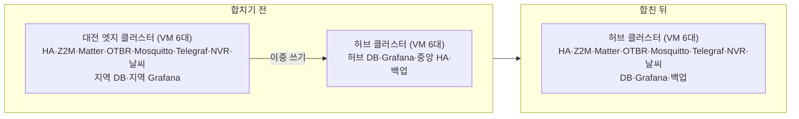

허브 클러스터와 대전 엣지 클러스터, 두 개의 kubeadm 클러스터로 돌리던 홈랩 IoT 스택을 2026-10-22 에 허브 클러스터 하나로 합쳤습니다. 엣지에 있던 Home Assistant, Zigbee2MQTT, Matter 서버, OpenThread Border Router, Mosquitto, Telegraf, NVR, 날씨 수집기를 허브로 옮기고, 지역 DB·지역 Grafana·중앙 HA(Remote Home Assistant)는 없앴습니다. 기기 쪽에서 보이는 주소(서비스 VIP 와 내부망 DNS 이름)는 그대로 두어 기기 설정을 바꾸지 않았고, 수집 공백은 약 19.5분, 기록 유실은 0건이었습니다. 순서는 다음과 같습니다.

1. 저장소를 평탄화하고 허브에 같은 서비스를 복제본 0 으로 미리 배포합니다.
2. 엣지 DB 와 허브 DB 의 행을 대조해 엣지에만 있는 행과 서로 다른 행을 찾아 둡니다.
3. 엣지 워크로드를 순서대로 멈추고, 볼륨을 허브로 복사해 네 가지 방법으로 대조합니다.
4. 서비스 VIP 와 DNS 이름을 허브로 옮기고 허브 워크로드를 켭니다.
5. DB 를 다시 대조해 빠진 행을 넣고 충돌 행을 보존한 뒤, 실제 동작을 확인합니다.
6. 하루 뒤 야간 작업(백업 등)까지 확인하고 엣지 클러스터를 철거합니다.

## 1. 왜 합쳤는가

[허브-엣지 구조](/posts/62/)는 지역이 다른 곳에 있어 인터넷이나 허브가 끊겨도 지역이 스스로 돌아가야 할 때 값이 있습니다. 그런데 대전 엣지 클러스터의 VM 여섯 대는 허브 클러스터와 **같은 Proxmox 호스트 세 대** 위에 있었습니다. 호스트가 꺼지면 두 클러스터가 함께 꺼지므로 지역 자립이라는 전제가 성립하지 않았고, 남는 것은 비용과 운영 부담뿐이었습니다.

| 항목 | 대전 엣지 클러스터가 쓰던 양 |
| :--- | :--- |
| VM | 6대 (control plane 3, worker 3) |
| vCPU | 22 |
| 메모리 | 30 GiB |
| 시스템 디스크 | 216 GB |
| Longhorn 디스크 | 360 GB |

운영 쪽에서는 다음이 두 벌이었습니다.

- Argo CD 의 배포 대상(허브 in-cluster 와 원격 엣지 클러스터)과 `kubeconfig`
- TimescaleDB (엣지 Telegraf 가 지역 DB 와 허브 DB 에 이중 쓰기) 와 Grafana
- Home Assistant (지역 HA 와, Remote Home Assistant 로 지역 엔티티를 모으는 중앙 HA)
- 백업 CronJob 과 그 Secret, 그리고 엣지 전용 인자를 받는 Secret 생성 스크립트

## 2. 합친 뒤 구조

- 저장소: `iot/hub/`, `iot/edge/`, `iot/clusters/<지역>/` 세 층을 `iot/<이름>/` 한 층으로 평탄화했습니다. ApplicationSet 은 모든 폴더를 허브(in-cluster)에 배포합니다.
- 이름: 서비스는 `ha-dj`, `z2m-dj`, `matter-dj` 처럼 지역 접미사를 유지하고, 데이터의 `site` 키는 `daejeon` 그대로입니다. 지역이 늘면 `<지역>-<장소>` 로 붙입니다.
- 주소: 기기가 바라보는 서비스 VIP(`[SERVICE_VIP]`)를 엣지 keepalived 에서 허브 keepalived 로 옮기고, 내부망 DNS 의 `ha-dj`·`z2m-dj`·`matter-dj` 이름을 허브 VIP 로 돌렸습니다. 기기와 휴대폰 앱 설정은 바뀐 것이 없습니다.
- 없앤 것: 지역 DB·지역 Grafana(허브 DB·Grafana 가 유일한 저장소·화면), 중앙 HA(지역 HA 가 유일한 HA), 엣지 웹 프록시 네임스페이스, Argo CD 의 원격 클러스터 등록.
- 바꾼 것: Telegraf 는 DB 출력 하나(`LOCAL_PG_*`)만 쓰고, 날씨 수집기의 두 번째 DB(`DB_HUB`)는 비웁니다. Home Assistant 의 신뢰 프록시는 허브 control plane 주소 세 개와 파드 대역으로 바꿨습니다.

## 3. 저장소 평탄화와 사전 배포

엣지 공통 베이스와 지역 오버레이를 합쳐 `iot/<이름>/` 에 완성된 매니페스트로 두고, 복제본을 0 으로 해서 허브에 먼저 동기화했습니다. 이때 허브에 생기는 것은 네임스페이스, PVC, Service, IngressRoute 같은 틀이고 파드는 뜨지 않습니다. 틀이 먼저 있어야 다음 단계에서 볼륨을 복사할 PVC 가 허브에 있고, 전환 때는 복제본만 1 로 바꾸면 됩니다.

Secret 은 저장소에 넣지 않으므로 허브 네임스페이스에 다시 만들었습니다. 이 블로그의 [create-iot-secrets.sh](/posts/43/), [create-backup-secrets.sh](/posts/50/), [create-nvr-secrets.sh](/posts/76/), [create-weather-secret.sh](/posts/52/) 는 엣지 `kubeconfig` 인자를 받던 것을 이번에 단일 클러스터용으로 고쳤습니다. 각 글의 전문도 같이 바뀌었습니다.

- **확인:** 허브 Argo CD 에 옮긴 Application 들이 `Synced`·`Healthy` 이고, 허브의 각 네임스페이스에 PVC 가 `Bound`, Deployment 는 `0/0` 입니다.

## 4. DB 행 대조

엣지 Telegraf 는 지역 DB 와 허브 DB 에 같은 행을 썼지만, 두 DB 가 완전히 같다고 믿지 않고 대조했습니다. 허브 주 DB 에 작업 표를 만들고, 엣지 주 DB 의 `site = 'daejeon'` 행을 하루 단위로 `COPY ... (FORMAT binary)` 로 받아 넣은 뒤 `EXCEPT` 로 차이를 구합니다. 차이가 난 행은 키(`time, site, room, device, anchor, property, processing`)가 허브에 있는지에 따라 **누락**(키도 없음)과 **충돌**(키는 있는데 어느 칼럼이 다름)로 나누고, 충돌은 양쪽 원문을 함께 남깁니다. `events` 는 행 전체가 키이고, `incidents` 는 `(time, cluster, event_uid, count)` 가 키입니다. 대조 전에 양쪽의 중복 정리 작업(`dedup_readings`)을 멈추고 한 번씩 실행해 기준을 맞췄습니다.

대조는 두 번 합니다. 전환 전날까지를 먼저 대조해 두고, 엣지 수집기를 멈춘 뒤 마지막 날을 다시 대조합니다. 첫 번째 대조로 이관 SQL 을 미리 검증할 수 있고, 두 번째 대조는 하루치만이라 전환 중 멈춰 있는 시간이 짧습니다.

- **확인:** 대조 요약이 `readings: 누락 0, 충돌 146`, `events: 누락 0`, `incidents: 누락 14` 였습니다. 충돌 146쌍은 같은 키의 행이 두 DB 에서 값이 조금 다른 경우로, 어느 쪽이 맞는지 이 자리에서 고르지 않고 보존 표에 둘 다 남기기로 했습니다.

## 5. 엣지 정지와 볼륨 복사

수집 공백이 시작되는 지점입니다. 멈추기 전에 Telegraf 의 디스크 버퍼(WAL 세그먼트)가 모두 0바이트인지 40초 동안 확인해, 아직 DB 에 못 쓴 행이 없다는 것을 보고 멈췄습니다. 정지 순서는 Telegraf → Home Assistant → Matter 서버 → OTBR → Zigbee2MQTT → NVR → 날씨 수집기 → Mosquitto → Grafana 이고, 각 Deployment 를 0 으로 줄인 뒤 파드가 실제로 사라진 것까지 기다립니다. 이벤트 수집기(infra-events)는 보류 중인 이벤트가 0 인 것을 보고 마지막에 멈췄습니다.

볼륨은 Longhorn 의 백업·복원 대신 **임시 파드 두 개와 tar 파이프**로 복사했습니다. 엣지와 허브의 같은 PVC 를 각각 임시 파드에 마운트하고, `kubectl exec ... tar cf - | kubectl exec -i ... tar xf -` 로 흘려보냅니다. 복사 뒤 양쪽에서 네 가지 목록을 뽑아 `diff` 로 대조했습니다.

| 대조 항목 | 내용 |
| :--- | :--- |
| 파일 해시 | 모든 파일의 `sha256sum` |
| 파일 속성 | 권한, 소유자, 그룹, 크기, 경로 |
| 디렉터리 | 권한, 소유자, 그룹, 경로 |
| 심볼릭 링크 | 경로와 대상 |

복사한 볼륨은 Home Assistant 설정, Zigbee2MQTT 데이터, Matter 서버 데이터, OTBR 데이터, Mosquitto 데이터, NVR 녹화 저장소, Telegraf 버퍼 일곱 개입니다. Home Assistant 는 복사한 뒤 `.storage/http` 의 `trusted_proxies` 를 허브 control plane 주소 세 개와 파드 대역으로 바꿨습니다. 엣지에서는 VIP 를 가진 엣지 control plane 이 SNAT 한 주소였고, 허브에서는 Traefik 인그레스(파드 대역)로도 들어오기 때문입니다.

- **확인:** PVC 일곱 개 모두 tar 의 양쪽 종료 코드가 0 이고 네 가지 대조가 모두 일치했습니다.

## 6. VIP·DNS 이동과 허브 기동

서비스 VIP 는 proxmox-ansible 의 변수에서 엣지 클러스터의 `service_vip` 를 지우고 허브 클러스터에 같은 값을 적은 뒤 keepalived 태스크만 다시 적용해 옮겼습니다. 내부망 DNS 는 허브의 `lan_dns_names` 에 `ha-dj`·`z2m-dj`·`matter-dj` 를 넣고 DNS 플레이북을 다시 돌렸습니다. 그다음 허브의 Deployment 복제본을 1 로 올리고, 허브 Traefik 의 IngressRoute 우선순위를 내부망(40) > 외부(30) 로 두어 같은 호스트 이름이 두 경로로 들어와도 내부망 경로가 먼저 잡히게 했습니다.

- **확인:** `arping` 으로 VIP 의 MAC 이 허브 control plane 한 대의 것이고 엣지 control plane 은 VIP 를 놓았습니다. `dig` 로 세 DNS 이름이 허브 VIP 를 가리킵니다. 허브 Telegraf 가 06:58:20 에 첫 행을 썼고, 엣지 Telegraf 를 멈춘 06:38:51 부터의 공백은 약 19.5분이었습니다.

## 7. DB 이관과 동작 확인

허브 수집이 재개된 뒤 마지막 날을 다시 대조하고 이관 SQL 을 실행했습니다. SQL 은 작업 표의 누락 행을 `readings`·`events`·`incidents` 에 넣고(이미 있으면 넣지 않음), 충돌 행은 양쪽 원문을 `jsonb` 로 보존 표에 남깁니다. 끝에 확인 쿼리가 있어 누락 행이 모두 들어갔는지, 넣은 키에 중복이 없는지, 보존 표의 행 수가 충돌 수와 같은지 중 하나라도 어긋나면 커밋하지 않습니다. 먼저 `--dry-run`(ROLLBACK)으로 돌려 보고 실제 실행했습니다.

| 결과 | 값 |
| :--- | :--- |
| 수집 공백 | 2026-10-22 06:38:51 ~ 06:58:20 KST (약 19.5분) |
| `readings` 누락 | 0행 |
| `readings` 충돌 | 146쌍 (292행 보존) |
| `events` 누락 | 0행 |
| `incidents` 이관 | 14행 |
| Grafana 패널 | 85개 모두 정상 |

동작 확인은 다음을 보았습니다. 허브 Argo CD 의 IoT Application 8개가 `Synced`·`Healthy`, Home Assistant 가 내부망 주소와 외부 주소에서 모두 200, Zigbee2MQTT 와 Matter 프런트엔드 200, MQTT 포트 열림, Zigbee2MQTT 의 코디네이터 연결, OTBR 의 Thread 역할 `router`, Matter 노드 목록, NVR 녹화 파일 증가, 날씨 수집기가 공백 구간을 백필, 원본(`source`)별로 `readings` 가 다시 들어오는지, 그리고 [Grafana 대시보드](/posts/56/)의 패널 85개를 API 로 모두 실행했습니다. 마지막으로 멈춰 두었던 `dedup_readings` 작업을 허브에서만 다시 켰습니다.

## 8. 되돌리는 법

엣지 클러스터는 Deployment 를 0 으로 줄였을 뿐 지우지 않았으므로, 하루 동안은 다음 순서로 되돌릴 수 있었습니다.

1. 허브 Deployment 를 0 으로 줄입니다.
2. proxmox-ansible 변수를 전환 전 커밋으로 되돌리고 keepalived 와 DNS 플레이북을 다시 돌립니다.
3. 엣지 Deployment 를 1 로 올립니다.

허브 DB 에는 이관으로 행을 넣기만 했고(갱신·삭제 없음) 충돌 행은 별도 표에 있으므로, DB 는 되돌릴 것이 없습니다. 허브에서 켠 뒤 쌓인 행은 되돌리더라도 허브 DB 에 그대로 남습니다.

> 되돌릴 수 있는 기간은 엣지 볼륨을 지우기 전까지입니다. 허브에서 Home Assistant 나 Zigbee2MQTT 설정을 바꾼 뒤 되돌리면 그 변경은 엣지 볼륨에 없습니다.
{: .prompt-warning }

## 9. 철거

전환 당일에는 엣지 웹 프록시 네임스페이스, Argo CD 의 원격 클러스터 등록(cluster Secret), 옛 중앙 HA 가 쓰던 PVC 와 그 매니페스트를 지웠습니다. VM 삭제는 하루 뒤 야간 작업을 본 다음으로 미뤘습니다.

- 02:10~02:30 의 볼륨 백업 CronJob 다섯 개와 DB 백업이 `Completed` 인지. 볼륨 백업의 restic 호스트 이름은 `daejeon` 그대로 두어 스냅샷 이력이 이어집니다.
- descheduler 가 hostNetwork 로 묶인 IoT 사슬(HA·Matter·OTBR·Zigbee2MQTT)을 다른 노드로 옮기지 않는지.
- Longhorn 복제본 두 벌이 모두 `healthy` 인지.

이것까지 확인한 뒤 Proxmox 의 VM 여섯 대를 지우고, proxmox-ansible 의 지역 블록과 인벤토리, Cloudflare 의 옛 레코드, 작업 PC 의 엣지 `kubeconfig` 를 정리합니다. 대조에 쓴 작업 표(`_merge_dj_*`, `_edge_*`)는 검증이 끝난 뒤 별도 마이그레이션으로 지웁니다.

## 10. 배운 점

- **허브 API VIP 는 긴 `kubectl exec` 스트림 중에 흔들렸습니다.** VIP 가 다른 control plane 으로 옮겨 가면 그 VIP 를 거치던 exec 스트림이 끊깁니다. 볼륨 복사처럼 오래 가는 스트림은 `--server=https://[HUB_CP_IP]:6443` 처럼 control plane 주소로 직접 붙였습니다.
- **TimescaleDB 의 압축 청크에서는 행 전체 참조가 실패합니다.** 이관 SQL 에서 `to_jsonb(r)` 이나 `r.*` 비교로 하이퍼테이블 행을 통째로 다루자 `cache lookup failed for attribute 0 of relation` 오류가 났습니다(`readings` 청크 22개 중 20개가 압축 상태). 칼럼을 하나씩 `IS NOT DISTINCT FROM` 으로 비교하도록 고쳐 해결했습니다. 작업 표처럼 일반 테이블에서는 행 전체 참조가 됩니다.
- **멈추기 전에 버퍼를 봅니다.** Telegraf 의 디스크 버퍼가 비어 있는 것을 확인하고 멈춘 덕에 `readings` 누락이 0 이었습니다.
- **DB 가 같다고 믿지 않습니다.** 이중 쓰기였는데도 충돌 146쌍과 `incidents` 14행 차이가 있었습니다. 대조를 두 번으로 나누면 전환 중 멈춰 있는 시간을 하루치 대조로 줄일 수 있습니다.

## 관련 글

엣지 클러스터를 전제로 쓴 아래 글들은 각각 첫머리에 이 글로 안내를 달았습니다. 설치 절차 자체는 그대로 쓸 수 있고, "엣지 클러스터" 를 "허브 클러스터" 로 읽으면 됩니다.

- [Proxmox에 Ansible로 kubeadm 엣지 클러스터 만들고 Argo CD 원격 클러스터로 등록하는 방법](/posts/42/)
- [엣지 Mosquitto와 Telegraf 디스크 버퍼로 중앙 TimescaleDB에 유실 없이 IoT 데이터 모으는 방법](/posts/43/)
- [엣지 클러스터에 Home Assistant와 Matter 서버 배포하고 API로 통합 설정하는 방법](/posts/48/)
- [중앙 Home Assistant로 여러 지역 Home Assistant 모아 보는 방법](/posts/49/)
- [restic과 Cloudflare Tunnel로 쿠버네티스 볼륨과 DB를 원격 NAS에 백업하는 방법](/posts/50/)
- [지역 엣지에 TimescaleDB와 Grafana를 두어 인터넷 없이도 기록하고 보는 방법](/posts/56/)
- [허브-엣지 구조와 지역 자립(오프라인 우선) 설계란 무엇인가](/posts/62/)
